<div align="center">

# 🇩🇪 Sprichst

**Learn German by speaking it: lessons, an AI coach that explains why, and practice that comes back when you need it.**

Flutter · Firebase · on-device AI · bring-your-own-key AI · no tracking, no ads

[Overview](#-overview) · [Screens](#-screens) · [How it works](#-how-it-works) · [Prerequisites](#-prerequisites) · [Install](#-installation) · [Testing](#-testing) · [Next steps](#-next-steps) · [Contact](#-contact)

</div>

---

## ✨ Overview

Sprichst is a German-learning app built around a **curriculum and a learning engine**, not a generic chatbot. A learner signs in with Google, picks a goal and a starting level, and is then shown **one clear next step** every day.

| 🎯 | What you get |
| --- | --- |
| 📚 **Lessons** | 48 lessons from Pre-A1 to B2, 308 words, 13 dialogues, Goethe and TestDaF exam tracks |
| 🤖 **AI coach** | Chat and voice practice with corrections, reasons, and an **English translation of every question** so new words come with meanings |
| 🧠 **Smart practice** | A deterministic planner picks the next review, weak-skill drill or lesson from *your own answers*; spaced repetition brings things back |
| ⌨️ **Writing practice** | Type German sentences with **ä ö ü ß** keys at hand, with live feedback, speed and accuracy |
| 🔁 **Translator** | Translate any typed or pasted text **German ⇄ English**, on the phone or with your own AI key; copy, listen, swap, translate back |
| 🃏 **Flashcards & games** | Spaced-repetition cards and five games (Artikel-Rausch, Memory, Buchstabensalat, Wortle, Gespräch) |
| 🔒 **Private by design** | AI runs **on the phone**, or with the learner's **own key** from Groq, Gemini, OpenAI, Claude, Grok, Mistral, DeepSeek, OpenRouter or any OpenAI-compatible server. There is **no Sprichst AI server**, no analytics, no ads |
| 🌍 **Languages** | German today; the app says **more languages are coming soon** (welcome, first onboarding step, Learn and Account) and lets learners request one |
| 🎨 **Calm design** | Paper-and-ink look, one action per screen, light and dark, reduced-motion friendly, Lottie animations |

Runs on **Android, iOS, web, macOS** (and has Windows/Linux folders for later).

---

## 📱 Screens

These are rendered from the real app (`tool/screenshots_test.dart`), not drawings.

### First run

<table>
  <tr>
    <td align="center">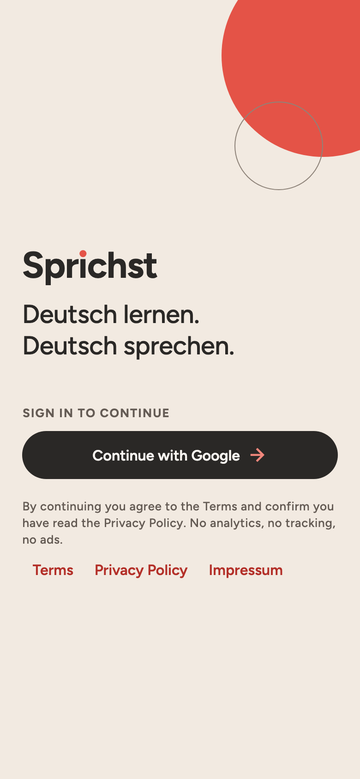<br><sub><b>1 · Sign in</b><br>Google, no tracking</sub></td>
    <td align="center">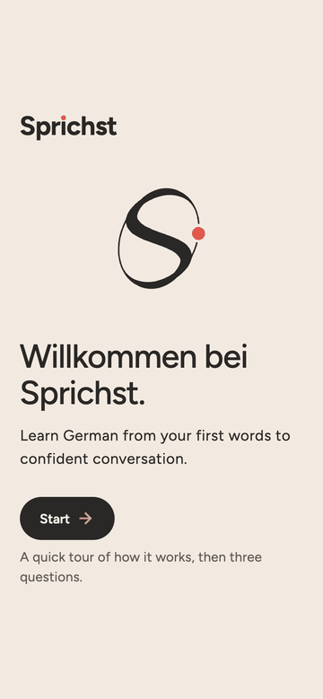<br><sub><b>2 · Welcome</b><br>animated mark</sub></td>
    <td align="center">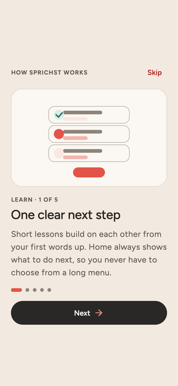<br><sub><b>3 · Tour</b><br>5 short pages</sub></td>
    <td align="center">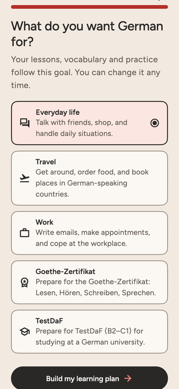<br><sub><b>4 · Your goal</b><br>language, level, goal</sub></td>
  </tr>
</table>

### Every day

<table>
  <tr>
    <td align="center">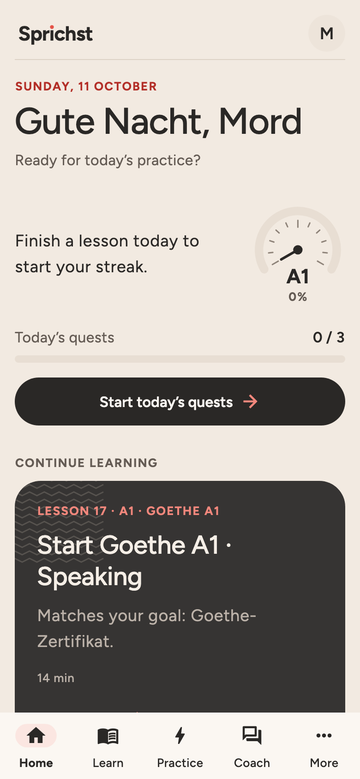<br><sub><b>🏠 Home</b><br>streak, level gauge, quests</sub></td>
    <td align="center">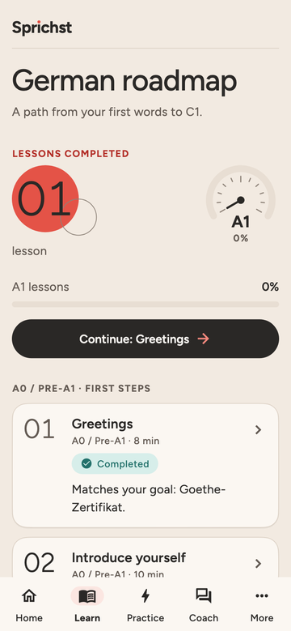<br><sub><b>📖 Learn</b><br>roadmap A0 → C1</sub></td>
    <td align="center">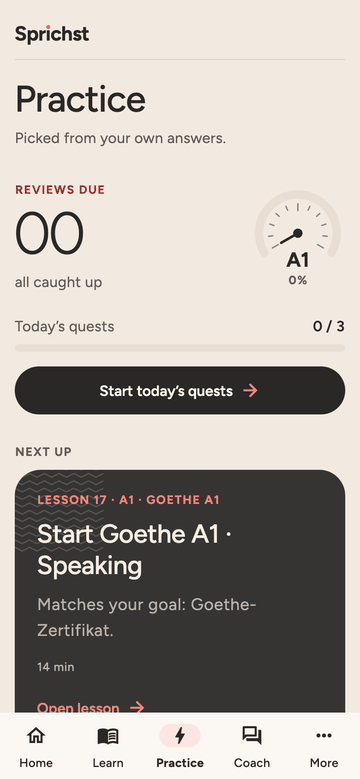<br><sub><b>⚡ Practice</b><br>reviews, cards, games</sub></td>
    <td align="center">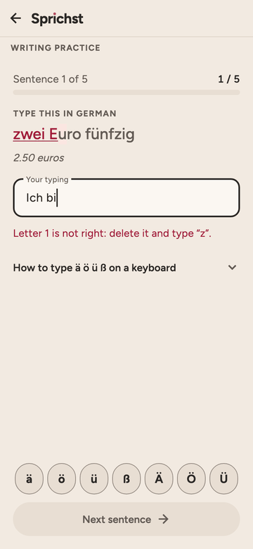<br><sub><b>⌨️ Writing</b><br>type with ä ö ü ß</sub></td>
  </tr>
  <tr>
    <td align="center">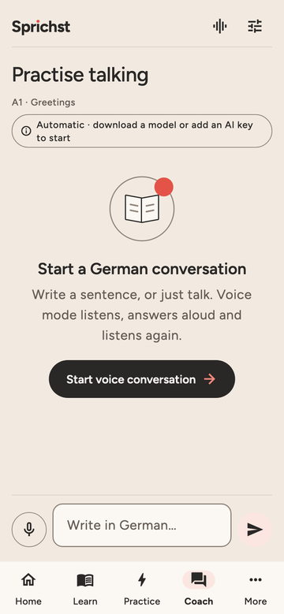<br><sub><b>💬 Coach</b><br>chat or talk</sub></td>
    <td align="center">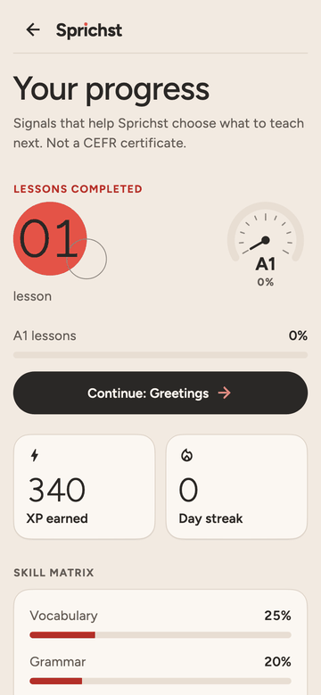<br><sub><b>📈 Progress</b><br>skills, badges</sub></td>
    <td align="center">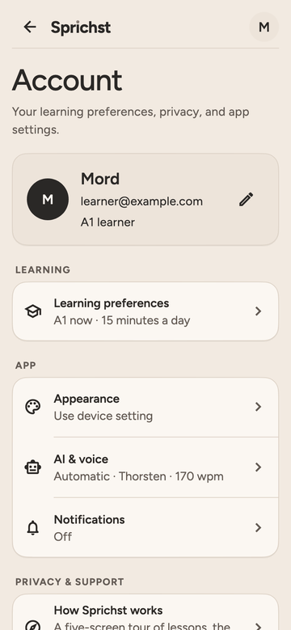<br><sub><b>👤 Account</b><br>AI key, voice, privacy</sub></td>
    <td align="center">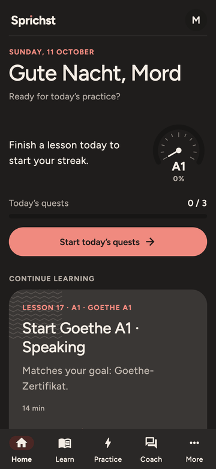<br><sub><b>🌙 Dark mode</b><br>designed on its own</sub></td>
  </tr>
</table>

---

## 🔄 How it works

### The learner's journey

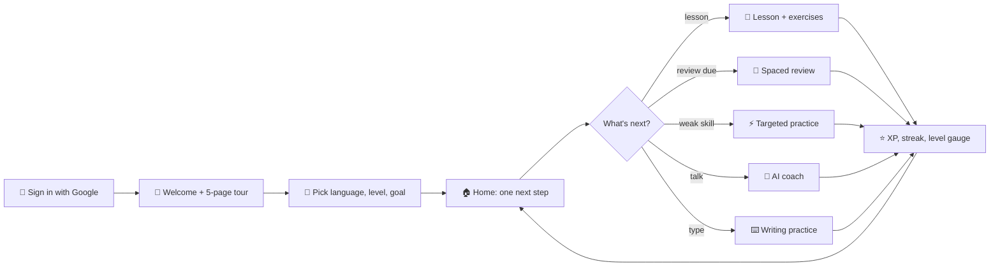

1. **Onboarding** sets the starting CEFR level and a goal (everyday, travel, work, Goethe-Zertifikat or TestDaF). The path, vocabulary and practice follow the goal.
2. **Home** shows the streak, a level gauge that sweeps up from 0 on every refresh, today's three quests (each with its own *Start* button) and the single recommended step.
3. **Every answer feeds the planner.** Accuracy per skill decides what comes back, when, and how hard it is. Missed exercises are retried and re-spaced. Finishing a level well moves you up.
4. **The coach** corrects only real mistakes, explains why in English, remembers the last few messages so it doesn't repeat questions, and translates its follow-up question.

### Where the AI runs (you choose)

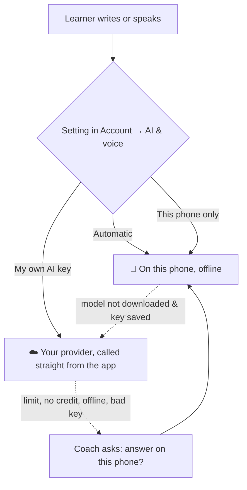

Nothing switches silently, and keys never leave the device's secure storage. Details: [docs/zero-cost-architecture.md](docs/zero-cost-architecture.md), [docs/on-device-ai.md](docs/on-device-ai.md).

### How the code is organised

```text
lib/
├── app/          app shell, navigation, theme, controller (state)
├── domain/       pure Dart: planner, progress tracker, quests, typing practice, exercise evaluator
├── data/         repositories: Firebase auth/Firestore, on-device AI, cloud AI, sync, curriculum parser
├── features/     one folder per screen: home, learn, practice, ai_coach, onboarding, account, ...
└── shared/       design-system widgets, Lottie player, masthead
curriculum/       course.json: the version-controlled course (validated by a script and the app)
assets/lottie/    animations, generated by tool/lottie/gen_lottie.py
firebase/         Firestore and Storage rules (+ rules tests)
ai-server/        optional developer-only FastAPI gateway (not in the released app)
docs/             architecture, setup, deployment, AI, voice
legal/            privacy policy, terms, AI transparency, ... (templates)
test/             ~540 unit and widget tests; tool/ has previews and screenshot rendering
```

Layers depend downward only: `features → domain ← data`. An LLM never controls review dates or touches the database; the learning engine is deterministic and tested.

---

## ✅ Prerequisites

| Tool | For | Notes |
| --- | --- | --- |
| **Flutter** (stable, 3.47+) with Dart 3.5+ | everything | `flutter doctor` should be green for your target |
| **Android Studio** + Android SDK 35 | Android | accept licences: `flutter doctor --android-licenses` |
| **Xcode** + CocoaPods | iOS and macOS | a free Apple ID is enough for simulators; a paid team for devices and release |
| **Chrome** | web | |
| **Firebase CLI** (`npm i -g firebase-tools`) and a Firebase project | real sign-in and sync | not needed for the preview mode below |
| **Python 3.10+** | scripts (course validation, legal checks, icons, Lottie) | Pillow for icons |
| **Node 18+** | Firestore rules tests only | |
| *Optional:* Ollama | the developer AI gateway | |

---

## 🛠 Installation

```bash
git clone https://github.com/Sripathiyadav/Sprichst.git
cd Sprichst
flutter pub get
```

### Fastest: preview with no Firebase, no AI

`tool/preview_main.dart` runs the real app with a fake signed-in learner and seeded progress.

```bash
flutter run -t tool/preview_main.dart -d chrome
```

### The real app (Google sign-in + sync)

1. Create a Firebase project, enable **Google** sign-in and **Firestore**.
2. `dart pub global activate flutterfire_cli && flutterfire configure` writes `lib/firebase_options.dart` (git-ignored, on purpose).
3. **Android:** register your debug SHA-1 (`firebase apps:android:sha:create <appId> <sha1>`) and download `google-services.json` into `android/app/`.
4. **iOS:** put `GoogleService-Info.plist` in `ios/Runner/`; the URL scheme in `Info.plist` must match its `REVERSED_CLIENT_ID`. Keychain Sharing is already set in `Runner.entitlements`.
5. Deploy the rules: `cd firebase && firebase deploy --only firestore:rules,storage`.
6. Run: `flutter run` (pick a device), or `flutter run -d chrome`.

Full click-by-click guide: [docs/SETUP.md](docs/SETUP.md).

### Run with (or without) the developer AI server

You never need `ai-server/`. The released app does not use it, and in debug builds the app works without it too: the AI runs on the phone or with your own key. If you want the optional server while developing, one command starts it with the app and stops it when the app stops:

```bash
scripts/dev.sh -d chrome        # app + server (extra arguments go to flutter run)
scripts/dev.sh --no-server      # app only
```

### Use an AI coach

* **On the phone:** Account → AI & voice → *Models on this phone* → download once (use Wi-Fi), then it works offline.
* **Your own key:** Account → AI & voice → *My own AI key* → choose a provider, paste the key, *Save and test*. Free tiers exist at Groq, Gemini and OpenRouter.

### Build

```bash
flutter build web --release            # then: firebase deploy --only hosting
flutter build appbundle --release      # Android (see docs/DEPLOYMENT.md for signing)
flutter build ipa --release            # iOS
flutter build macos --release          # macOS (needs an Apple team for sign-in)
```

---

## 🧪 Testing

```bash
flutter analyze                                   # static analysis, must be clean
flutter test                                      # ~540 unit + widget tests
python3 scripts/validate_curriculum.py            # course content
python3 scripts/check_legal_placeholders.py       # open [[PLACEHOLDER]] fields in legal/
python3 scripts/generate_third_party_notices.py --check
cd firebase && npm install && npm test            # Firestore security rules (emulator)
SHOT_DIR=build/shots flutter test tool/screenshots_test.dart   # render screens to PNG
```

What the tests cover: the planner and spaced repetition, exercise evaluation, typing practice, every screen at five sizes and up to 2× text, accessibility (contrast, targets, screen-reader labels), security (no secrets or tracking hosts in the repo, `security_audit_test`, `privacy_audit_test`), cloud-AI request shapes for every provider, and the sign-in and refresh flows.

**CI:** every pull request runs analyze, tests, notices, course validation, a web build and an Android release build ([.github/workflows/ci.yml](.github/workflows/ci.yml)). The real Firebase files are not in Git, so CI writes placeholders with `scripts/ci_firebase_stub.py`.

Last verified on web, Android, iOS (simulator) and macOS: see [docs/DEPLOYMENT.md](docs/DEPLOYMENT.md).

---

## 🚀 Next steps

The full plan is in **[docs/DEPLOYMENT.md](docs/DEPLOYMENT.md)**. In short:

1. ✅ App id is `com.sprichst.app` on Android, iOS and macOS, registered in Firebase. Check it is free in Play Console before the first upload; it is permanent after that.
2. ✅ Legal fields are filled and the policies are public at `https://sprichst.app/legal/`. Have the terms read by a lawyer.
3. 🔑 **Play App Signing fingerprints** in Firebase after the first upload, and an **Apple Developer account** for iOS and macOS.
4. ✅ The web build is live on Firebase Hosting (`scripts/deploy_web.sh`).
5. 🤖 **Android closed test** (12 testers, 14 days; see `store/play/LISTING.md`) and **TestFlight**, then public launch.
6. 💡 **Ideas after launch:** XP and a daily quest for writing practice, typing speed over time, more B1/B2 lessons, a Windows build, a translated app interface.

---

## 🔐 Privacy, security and legal

* No analytics, no ads, no third-party requests from the web app (fonts and SDKs are bundled).
* API keys live only in the device's secure storage and are never synced, logged or put in the profile.
* Firestore rules let a signed-in user touch only their own documents and validate every field.
* The [legal/](legal/README.md) folder holds the privacy policy, terms, AI transparency, cookies, your rights, impressum and more. They are **templates, not legal advice**.

Report a vulnerability: see [SECURITY.md](SECURITY.md).

---

## 🧩 More documentation

| Doc | About |
| --- | --- |
| [docs/DEPLOYMENT.md](docs/DEPLOYMENT.md) | test results, blockers, release steps, running costs, next moves |
| [docs/SETUP.md](docs/SETUP.md) | Firebase and platform setup, click by click |
| [docs/architecture.md](docs/architecture.md) | layers and data flow |
| [docs/learning-design.md](docs/learning-design.md) | why the learning engine works the way it does |
| [docs/on-device-ai.md](docs/on-device-ai.md) | local models, sizes, offline behaviour |
| [docs/zero-cost-architecture.md](docs/zero-cost-architecture.md) | bring-your-own-key AI, free quotas |
| [docs/voice.md](docs/voice.md) | voice mode and speech |
| [assets/lottie/README.md](assets/lottie/README.md) | the animations |

<details>
<summary><b>Developer AI gateway (optional, not part of the released app)</b></summary>

`ai-server/` is a FastAPI gateway kept for experiments (for example trying Ollama models on a Mac). Debug builds, and anyone who types an address in Account → AI & voice, can use it; released builds ignore it.

```bash
ollama pull qwen2.5:0.5b-instruct && ollama serve
cd ai-server && python3 -m venv .venv && source .venv/bin/activate
pip install -r requirements.txt
uvicorn app.main:app --reload --port 8000     # check http://127.0.0.1:8000/health
```

Voices (Piper, open source): `pip install -r requirements-voices.txt && python3 scripts/download_voices.py`. See [docs/voice.md](docs/voice.md). Keep the gateway behind authentication and HTTPS if you ever expose it.

</details>

---

## 📬 Contact

**Sripathi** · maker of Sprichst

* 🐙 GitHub: [@Sripathiyadav](https://github.com/Sripathiyadav)
* ✉️ Email: [sripathiyadav66@gmail.com](mailto:sripathiyadav66@gmail.com)
* 🐞 Bugs and ideas: [open an issue](https://github.com/Sripathiyadav/Sprichst/issues)

Viel Spaß beim Lernen! 🎉
